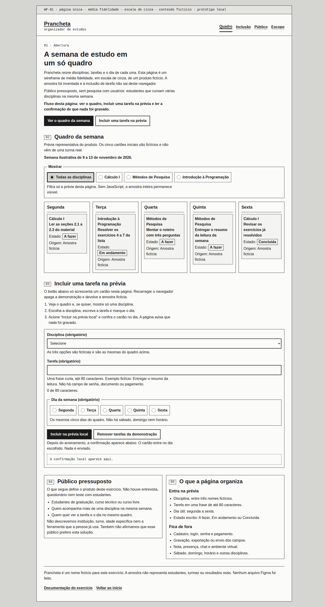
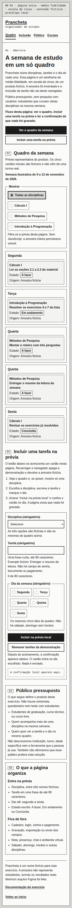
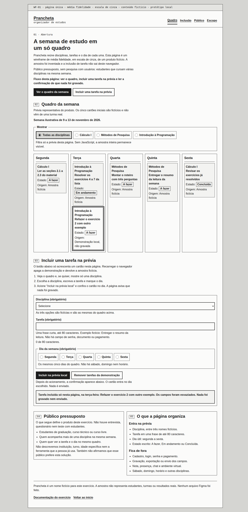
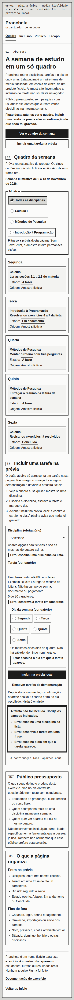

# Prancheta — wireframe de organizador de estudos

Repositório `wireframe-organizador-estudos`. Entrega de laboratório para portfólio: uma página em wireframe de média fidelidade, em escala de cinza, do organizador fictício **Prancheta**.

Não há arquivo do Figma neste repositório. Os desenhos editáveis são SVG. A página HTML é o protótipo navegável. Nada aqui é um produto publicado, uma pesquisa com usuários ou um sistema que grave dados.

## Desafio e contexto

O exercício pede uma página única que apresente um organizador de estudos e documente as decisões de design com as heurísticas de Nielsen e os critérios ergonômicos de Bastien e Scapin. O repositório chegou só com o título. Este README substitui aquele título; não havia outro conteúdo a preservar.

A página não é um site de marketing, nem um aplicativo com backend. É uma prancha de média fidelidade: hierarquia, conteúdo de exemplo e um fluxo curto que a pessoa consegue percorrer no navegador.

## Produto, público e pressupostos

**Prancheta** é um nome fictício deste exercício. A proposta é um quadro semanal em que o estudante vê disciplinas, tarefas e o dia de cada uma.

Público pressuposto, definido para o exercício e **não** medido:

- estudantes de graduação, curso técnico ou curso livre;
- pessoas que acompanham mais de uma disciplina na mesma semana;
- pessoas que querem ver a tarefa e o dia no mesmo quadro.

Não houve entrevista, questionário nem teste com estudantes. Não se afirma instituição, turno, idade específica, ferramenta que a pessoa já usa, nem que esse público preferiria esta solução. A frase está repetida na própria página, na seção “Público pressuposto”.

A amostra do quadro — Cálculo I, Métodos de Pesquisa e Introdução à Programação, na semana ilustrativa de 9 a 13 de novembro de 2026 — foi inventada. Não representa turma, pessoa ou resultado real.

## Objetivo e fluxo

Objetivo da página: fazer a pessoa reconhecer o quadro da semana e experimentar uma inclusão que permanece só naquele navegador.

Fluxo representado, também escrito na abertura:

1. Ver o quadro da semana.
2. Incluir uma tarefa na prévia.
3. Ler a confirmação de que nada foi gravado.

O botão primário da abertura é **Ver o quadro da semana**. Ele leva à seção do quadro. O outro botão, com contorno, leva ao formulário local. Na inclusão, o botão primário daquele bloco é **Incluir na prévia local**. Não há cadastro.

## Escopo e não escopo

Entra na prévia:

- disciplina, entre três nomes fictícios;
- tarefa em uma frase de até 80 caracteres;
- dia útil, de segunda a sexta;
- estado escrito: A fazer, Em andamento ou Concluída.

Fica de fora:

- conta, login, senha e pagamento;
- gravação, exportação ou envio dos campos;
- nota, presença, chat e ambiente virtual de aprendizagem;
- sábado, domingo, horário e disciplina fora das três amostras;
- depoimentos, métricas de uso e qualquer número apresentado como resultado de pesquisa.

A inclusão some ao recarregar a página. O filtro e a inclusão dependem do script local. Sem JavaScript, o quadro fictício continua visível e nenhum campo é enviado, porque os controles não estão dentro de um formulário.

## Por que média fidelidade

Média fidelidade, neste exercício, quer dizer:

- texto real em português, no lugar de caixas mudas ou “lorem ipsum”;
- hierarquia, alinhamento e componentes reconhecíveis (navegação, botões, campos, cartões);
- uma ação que dá para percorrer;
- escala de cinza, traço e rótulos de prancha, sem identidade visual de marca.

Não é baixa fidelidade: não há letra de rascunho nem blocos sem conteúdo. Não é alta fidelidade: não há cor de marca, fotografia, sombra, cantos arredondados de produto final nem sistema de componentes para produção. A barra do topo diz “WF-01 · página única · média fidelidade · escala de cinza”.

## Layout e seções

A página é uma só. A navegação aponta para âncoras. O cabeçalho não fica fixo, para não cobrir o título quando a âncora é acionada.

| Trecho | O que a pessoa vê |
| --- | --- |
| 01 Abertura | O que é a Prancheta, o pressuposto de público e o fluxo. Um botão preenchido e um com contorno. |
| 02 Quadro da semana | Semana ilustrativa e cinco colunas, segunda a sexta, no desktop. No estreito, os dias empilham. |
| Filtro “Mostrar” | Todas as disciplinas ou uma das três. Só altera a prévia desta página. |
| 03 Inclusão | Três passos, disciplina, tarefa, dia e a confirmação local. |
| 04 Público pressuposto | A definição de público e o aviso de que não houve pesquisa. |
| 05 Escopo | O que entra na prévia e o que fica de fora. |

Cada cartão de tarefa usa a mesma ordem: disciplina, frase da tarefa, estado, origem. A origem da amostra é “Amostra fictícia”. A origem de uma inclusão é “Demonstração local, não gravada”.

## Como abrir localmente

Não há dependência, framework nem conta. O CSS e o JavaScript são arquivos locais. A fonte é a que já estiver na máquina (`Liberation Sans` ou Arial).

Na pasta do repositório:

```bash
python3 -m http.server 8000
```

Abra `http://127.0.0.1:8000/`. Também é possível abrir `index.html` direto no navegador: o script não é módulo. Esta entrega não publica a página e não configura GitHub Pages.

## SVG e Figma

**Nenhum arquivo `.fig` foi produzido.** Não houve edição dentro do Figma. Os arquivos abaixo são a fonte editável para quem quiser importar:

- [`wireframes/prancheta-desktop.svg`](wireframes/prancheta-desktop.svg) — prancha desktop, 1280 px de largura;
- [`wireframes/prancheta-mobile.svg`](wireframes/prancheta-mobile.svg) — prancha estreita, 390 px de largura.

Os dois mostram o estado inicial, antes de qualquer inclusão. A interação existe só no HTML.

Como importar no Figma:

1. Use File → Import, ou arraste o SVG para o canvas.
2. O texto está em elementos `<text>`, não em curvas, para continuar editável. O Figma pode substituir Arial e Courier New por fontes locais.
3. Os grupos viram camadas: `anotacao`, `cabecalho`, `abertura`, `quadro`, `inclusao`, `publico`, `escopo`, `rodape`.
4. A importação não cria auto-layout. O espaçamento pode ser reorganizado depois.
5. Não há imagem embutida, filtro, máscara nem script dentro do SVG.

Capturas de como esses SVG são desenhados pelo navegador: [desktop](images/svg-desktop.png) e [mobile](images/svg-mobile.png).

Há também uma impressão opcional do HTML inicial em [`export/prancheta-wireframe.pdf`](export/prancheta-wireframe.pdf): quatro páginas A4 em paisagem, geradas pelo Chrome a partir da folha de estilo de impressão. É a mesma página, não um desenho à parte. O texto foi extraído e está na ordem da interface; não revisei cada página num leitor visual de PDF.

## Estrutura do repositório

```text
index.html                          página única
css/wireframe.css                   apresentação em escala de cinza
js/prototipo.js                     filtro, inclusão e limpeza locais
wireframes/prancheta-desktop.svg    prancha editável, desktop
wireframes/prancheta-mobile.svg     prancha editável, mobile
images/                             capturas reais da página e dos SVG
export/prancheta-wireframe.pdf      impressão opcional do estado inicial
README.md                           esta documentação
```

## Capturas

Estado inicial no desktop (janela de 1440 px de largura):



Estado inicial em largura de 390 px. Os dias e os botões empilham; a página não ganha rolagem horizontal:



Depois de incluir, só nesta página, a tarefa fictícia “Refazer o exercício 2 com outro exemplo” na terça-feira. O cartão diz “Demonstração local, não gravada” e o texto abaixo dos botões diz que nada foi gravado nem enviado:



Tentativa sem disciplina, sem tarefa e sem dia, em 390 px. As três mensagens dizem o que falta:



## Decisões visíveis e heurísticas de Nielsen

Os nomes em inglês são os das [10 heurísticas de Nielsen](https://www.nngroup.com/articles/ten-usability-heuristics/), revisadas no texto da Nielsen Norman Group em 30 de janeiro de 2024. O conjunto vem de Nielsen (1994). A tradução ao lado é a forma corrente em português e não um segundo texto oficial.

| O que se vê na página | Decisão | Heurística |
| --- | --- | --- |
| “Tarefa incluída só nesta página… Nada foi gravado nem enviado.” O cartão novo traz “Demonstração local, não gravada”. O filtro anuncia “O quadro mostra…”. | O estado da prévia é dito em palavras, no ponto da ação e no cartão. | 1. Visibility of System Status — Visibilidade do status do sistema |
| “Disciplina”, “tarefa”, “segunda-feira”, “A fazer”, “Em andamento”, “Concluída”. | O vocabulário é o da semana de estudo, não o de um sistema interno. | 2. Match Between the System and the Real World — Correspondência entre o sistema e o mundo real |
| “Remover tarefas da demonstração” devolve a amostra e deixa a frase “Nada havia sido gravado”. “Voltar ao início” e as âncoras permitem sair do ponto atual. O cabeçalho não é fixo. | A pessoa desfaz a demonstração e percorre a página sem ficar presa num fluxo. | 3. User Control and Freedom — Controle e liberdade do usuário |
| Os cartões repetem disciplina, tarefa, estado e origem. Os botões primários são preenchidos e os secundários têm contorno, tanto na abertura quanto na inclusão. | O que se repete tem a mesma forma e o mesmo nome. | 4. Consistency and Standards — Consistência e padrões |
| Disciplina e dia são listas fechadas. A tarefa para em 80 caracteres. O sexto cartão de demonstração é recusado. Não existem campos de senha ou pagamento. | A interface reduz ocasiões de erro em vez de só avisar depois. | 5. Error Prevention — Prevenção de erros |
| As três disciplinas e os cinco dias estão visíveis. O quadro permanece na página enquanto a pessoa preenche a inclusão. | A escolha é reconhecimento de uma opção vista, não evocação de um código. | 6. Recognition Rather than Recall — Reconhecimento em vez de memorização |
| Âncoras, link “Pular para o conteúdo”, filtro por disciplina e uso por teclado. | Há mais de um jeito de chegar às seções. Não há atalho de usuário frequente: este protótipo não é uma ferramenta de uso diário, e inventar um atalho escondido iria contra a heurística 6. | 7. Flexibility and Efficiency of Use — Flexibilidade e eficiência de uso |
| Uma página, escala de cinza, um botão preenchido por região, sem depoimento e sem número de “resultado”. | O que está na tela serve ao fluxo. O que não serve ficou de fora. | 8. Aesthetic and Minimalist Design — Estética e design minimalista |
| “Erro: escolha uma disciplina da lista.” O resumo liga ao campo, o campo ganha `aria-invalid` e o texto já digitado não é apagado quando a validação falha. O botão de incluir continua acionável. | A mensagem diz o que aconteceu e o que fazer, e o valor digitado permanece para correção. Um botão desativado, sem texto, esconderia o diagnóstico. | 9. Help Users Recognize, Diagnose, and Recover from Errors — Ajudar a reconhecer, diagnosticar e recuperar-se de erros |
| Passos numerados, texto de ajuda sob cada campo e a seção “O que a página organiza”. Este README é a documentação longa. | A ajuda curta está ao lado da ação. O detalhe fica fora da prancha. | 10. Help and Documentation — Ajuda e documentação |

## Decisões visíveis e critérios de Bastien e Scapin

A fonte é Bastien e Scapin (1993), relatório técnico INRIA n.º 156, versão 2.1, nas listas em inglês e francês: [ficha HAL `inria-00070012`](https://inria.hal.science/inria-00070012/). O resumo do relatório fala em 18 critérios elementares; o sumário usado aqui organiza oito critérios principais. Não existe, neste repositório, uma edição do INRIA em português. Os nomes em português abaixo são a tradução corrente no ensino de IHC no Brasil, alinhada aos nomes franceses do relatório (`Guidage`, `Incitation`, `Charge de travail`, `Homogénéité/Cohérence`, `Signifiance des codes et dénominations`, e os demais).

O próprio relatório separa critérios próximos. A tabela respeita isso: legibilidade não é usada para classificar mensagem de erro nem feedback; presteza não é usada para classificar o texto que corrige um erro.

| O que se vê | Critério |
| --- | --- |
| Rótulos “Disciplina (obrigatório)”, “Tarefa (obrigatório)” e “Dia da semana (obrigatório)”. Exemplo fictício sob a tarefa. Passos 1, 2 e 3. Aviso de que não há campo de senha. | Condução / Presteza (`Guidance / Prompting`, `Guidage / Incitation`) |
| O rótulo fica junto do campo. As tarefas ficam dentro do dia. A confirmação fica abaixo dos botões. O erro do campo fica sob o campo. | Condução / Agrupamento e distinção por localização (`Grouping/Distinction by Location`) |
| Botão primário preenchido e secundário só com contorno. Estado dentro de uma caixa com a palavra, igual para “A fazer”, “Em andamento” e “Concluída”. Cartões com a mesma estrutura. | Condução / Agrupamento e distinção por formato (`Grouping/Distinction by Format`) |
| Ao incluir, filtrar ou limpar, a região de status muda na hora e diz o que a prévia fez. | Condução / Feedback imediato (`Immediate Feedback`). Pelo relatório, a qualidade desse texto é feedback, não legibilidade. |
| Texto de leitura em sans, 16 px, entrelinha 1,5, medida em torno de 65 caracteres na abertura. Contraste de `#1c1c1c` sobre `#fbfbfa` em 16,5:1. Anotações de prancha em mono, curtas. | Condução / Legibilidade (`Legibility`), aplicada ao texto comum, não às mensagens de erro. |
| Uma frase de tarefa, três disciplinas, cinco dias, um botão primário por região. | Carga de trabalho / Brevidade — concisão (`Brevity / Concision`) |
| Incluir pede um acionamento. Não há segundo passo de “confirmar envio”, porque não existe envio. | Carga de trabalho / Brevidade — ações mínimas (`Minimal Actions`) |
| Cinco cartões de amostra, não uma grade cheia. Ajuda em uma ou duas frases. | Carga de trabalho / Densidade informacional (`Information Density`) |
| Nada entra no quadro enquanto a pessoa digita. Só o botão inclui. Limpar é outro botão. | Controle explícito / Ações explícitas (`Explicit User Action`) |
| Dá para remover só a demonstração, trocar o filtro e usar as âncoras. Recarregar apaga a demonstração, e a página diz isso antes. | Controle explícito / Controle do usuário (`User Control`) |
| O filtro mostra uma disciplina. A mesma página muda de cinco colunas para uma coluna. | Adaptabilidade / Flexibilidade (`Flexibility`), num alcance pequeno. |
| Não há modo iniciante e modo especialista, nem preferência gravada. Há um único caminho. | Adaptabilidade / Consideração da experiência do usuário (`User Experience`). Este critério fica só em parte: a página não se adapta a níveis diferentes de experiência. |
| Listas fechadas, limite de caracteres e teto de cinco tarefas de demonstração. | Gestão de erros / Proteção contra os erros (`Error Protection`) |
| “Erro: escolha uma disciplina da lista.” “Erro: descreva a tarefa em uma frase.” “Erro: escolha o dia em que a tarefa aparece.” | Gestão de erros / Qualidade das mensagens de erro (`Quality of Error Messages`). Não foi classificado como presteza: o relatório reserva a presteza à condução sem erro. |
| O resumo aponta o campo. O valor da tarefa permanece se a validação falha. Os campos só são esvaziados depois de uma inclusão aceita, e a confirmação diz isso. | Gestão de erros / Correção dos erros (`Error Correction`) |
| Os mesmos três nomes de disciplina no filtro, no quadro e na lista. Os mesmos cinco dias. Os mesmos quatro dados em todo cartão. | Homogeneidade/Coerência (`Consistency` no sumário em inglês; `Homogénéité/Cohérence` no francês) |
| O estado é a palavra, não uma cor. A origem diz “Amostra fictícia” ou “Demonstração local, não gravada”. Não há ícone sem texto. | Significado dos códigos e denominações (`Significance of Codes`; `Signifiance des codes et dénominations`) |
| Semana de segunda a sexta, vocabulário de disciplina e tarefa, inclusão no singular. | Compatibilidade (`Compatibility`) com a tarefa suposta de organizar a semana de estudo. |

Há um custo consciente de concisão: o erro aparece no resumo e de novo junto do campo. A repetição ajuda a corrigir sem memorizar a frase. O relatório trata concisão e qualidade da mensagem de erro como critérios distintos; aqui a correção foi priorizada.

## Princípios psicológicos usados

Estes princípios não são heurísticas de Nielsen nem critérios de Bastien e Scapin. Nenhum tempo de reação foi medido nesta página. As citações apontam a fonte do princípio, não um resultado obtido com estudantes.

**Lei de Hick.** Hick (1952) descreveu a relação entre o número de alternativas e o tempo de escolha. Hyman (1953) estendeu essa relação. Na página, a escolha fica pequena: três disciplinas, cinco dias e um botão preenchido por região. Não se afirma quantos milissegundos isso economiza.

**Proximidade e região comum.** Na organização perceptiva descrita por Wertheimer (1923), itens próximos e itens dentro do mesmo contorno tendem a ser lidos como grupo. Por isso o rótulo cola no campo, a tarefa fica dentro do dia e a confirmação fica sob o botão que a produz. Uma síntese aplicada a interface, sem substituir o texto de Wertheimer, está em [NN/g sobre proximidade](https://www.nngroup.com/articles/gestalt-proximity/).

**Similaridade.** Cartões com a mesma estrutura permitem comparar tarefas sem reaprender o formato a cada dia. De novo, é o princípio de organização, não uma medida desta tela.

**Reconhecimento e evocação.** Reconhecer uma opção presente é mais fácil do que evocá-la sem pista. Budiu (2024) resume a distinção para interface, e a heurística 6 de Nielsen pede o mesmo. Na Prancheta, disciplina e dia são opções visíveis; a pessoa não precisa lembrar um código de curso. A discussão está em [Recognition and Recall](https://www.nngroup.com/articles/recognition-and-recall/).

**Agrupar a semana em dias.** Segunda a sexta aparecem como blocos porque essa é a semana de aula suposta no exercício. A divisão não se apoia no “sete mais ou menos dois”: esse número não justifica os cinco dias.

**Lei de Fitts.** Fitts (1954) relaciona o tempo para alcançar um alvo à distância e ao tamanho. Os botões têm altura mínima de 44 px e, abaixo de 600 px, ocupam a largura da coluna. Não houve medição de tempo de movimento.

**Figura e fundo, sem cor de marca.** O botão primário é o retângulo preenchido; o secundário é o contorno. A distinção não depende de uma cor. Os estados também não: a palavra é o código, e a caixa em volta só reforça.

## Validação feita e limitações

Ambiente: Google Chrome 156.0.8078.47, em modo headless, no Linux desta execução. A página não tem dependência de execução. O `axe-core` 4.10.3 foi usado só como ferramenta de teste, fora do repositório.

O que foi executado:

- Larguras de 1440, 390 e 320 px: `scrollWidth` do documento igual à largura visível e nenhum elemento com caixa além da janela.
- Teclado, com eventos reais do Chrome: 16 Tab a partir do topo, nesta ordem — pular para o conteúdo; Prancheta; Quadro; Inclusão; Público; Escopo; Ver o quadro da semana; Incluir uma tarefa na prévia; Todas as disciplinas; lista de disciplina; tarefa; Segunda; Incluir na prévia local; Remover tarefas da demonstração; Documentação do exercício; Voltar ao início. Seta para a direita e para a esquerda movem a escolha dentro de “Mostrar” e atualizam o texto de status.
- Inclusão vazia: três mensagens específicas e `aria-invalid="true"` em disciplina, tarefa e grupo do dia. Tarefa só com espaços é recusada. Uma inclusão válida gera o cartão “Demonstração local, não gravada”, esvazia os campos e escreve que nada foi gravado nem enviado. O filtro de outra disciplina esconde esse cartão e o texto avisa. “Remover tarefas da demonstração” apaga só a demonstração e mantém os cinco cartões de amostra. A sexta inclusão de demonstração é recusada.
- `axe-core` 4.10.3: zero violações no estado inicial, no estado com erros e no estado depois de uma inclusão.
- Contraste calculado para os pares usados: `#1c1c1c` sobre `#fbfbfa` 16,5:1; `#fbfbfa` sobre `#1c1c1c` 16,5:1; `#1c1c1c` sobre `#f3f3f1` 15,3:1; `#1c1c1c` sobre `#d9d9d6` 12,1:1; `#1c1c1c` sobre `#e4e4e1` 13,4:1; `#3a3a3a` sobre `#fbfbfa` 11,0:1. O axe também não apontou falha de contraste.
- SVG: os dois arquivos são XML bem formado. No navegador, texto, retângulo, linha e círculo ficam dentro do `viewBox` (desktop 1280×2195; mobile 390×4454).
- PDF: quatro páginas; o texto extraído contém a abertura, o quadro e a inclusão do estado inicial, sem a mensagem de erro.

Limitações, de propósito explícitas:

- Não houve teste com estudantes, entrevista ou avaliação heurística com vários avaliadores.
- Não houve sessão com pessoa usando leitor de tela. O axe e a ordem de tabulação não substituem isso.
- O SVG não foi importado no Figma nesta execução. A orientação de importação está acima; o arquivo `.fig` não existe.
- Não se afirma conformidade WCAG certificada. Os critérios mais próximos do que foi exercitado são 1.3.1, 1.4.1, 1.4.3, 2.1.1, 2.4.1, 2.4.7, 3.3.1, 3.3.2 e 4.1.2 da [WCAG 2.2](https://www.w3.org/TR/WCAG22/). O axe não cobre tudo, em especial a qualidade do foco percebida por uma pessoa e a leitura contínua num leitor de tela.
- A adaptabilidade à experiência do usuário permanece parcial, como registrado na tabela de Bastien e Scapin.
- Não assisti a vídeos de curso para escrever esta documentação. As decisões estão ligadas às fontes listadas abaixo.

## Próximos passos

Se o exercício continuasse, a ordem seria: observar estudantes organizando uma semana real; só então decidir se sábado, horário ou mais disciplinas entram; importar o SVG no Figma e ajustar o auto-layout; passar a alta fidelidade depois de o fluxo se manter. Conta, gravação e pagamento não são o passo seguinte: a página ainda não tem um motivo testado para pedi-los.

## Texto para a submissão na DIO

Wireframe de média fidelidade, em escala de cinza, de uma página para o organizador de estudos fictício Prancheta. O público é um pressuposto — estudantes com várias disciplinas na mesma semana — e não o resultado de pesquisa. A página mostra o quadro semanal, um filtro e a inclusão de uma tarefa só no navegador, sem cadastro e sem gravação. A entrega inclui HTML, CSS e JavaScript locais, dois SVG editáveis para importar no Figma (nenhum arquivo Figma foi produzido) e a relação das decisões visíveis com as heurísticas de Nielsen e os critérios de Bastien e Scapin.

## Referências

- Bastien, J. M. C., & Scapin, D. L. (1993). *Ergonomic criteria for the evaluation of human-computer interfaces* (Rapport technique n.º 156, version 2.1). INRIA. <https://inria.hal.science/inria-00070012/>
- Budiu, R. (2024, 15 de janeiro). *Memory recognition and recall in user interfaces*. Nielsen Norman Group. <https://www.nngroup.com/articles/recognition-and-recall/>
- Fitts, P. M. (1954). The information capacity of the human motor system in controlling the amplitude of movement. *Journal of Experimental Psychology, 47*(6), 381–391. <https://doi.org/10.1037/h0055392>
- Hick, W. E. (1952). On the rate of gain of information. *Quarterly Journal of Experimental Psychology, 4*(1), 11–26. <https://doi.org/10.1080/17470215208416600>
- Hyman, R. (1953). Stimulus information as a determinant of reaction time. *Journal of Experimental Psychology, 45*(3), 188–196. <https://doi.org/10.1037/h0056940>
- Nielsen, J. (1994). Enhancing the explanatory power of usability heuristics. *Proceedings of CHI ’94*, 152–158. <https://doi.org/10.1145/191666.191729>
- Nielsen, J. (1994, 24 de abril; revisão de 30 de janeiro de 2024). *10 usability heuristics for user interface design*. Nielsen Norman Group. <https://www.nngroup.com/articles/ten-usability-heuristics/>
- Nielsen Norman Group. *Gestalt principles: Proximity*. <https://www.nngroup.com/articles/gestalt-proximity/>
- W3C. (2024). *Web Content Accessibility Guidelines (WCAG) 2.2*. <https://www.w3.org/TR/WCAG22/>
- Wertheimer, M. (1923). Untersuchungen zur Lehre von der Gestalt, II. *Psychologische Forschung, 4*, 301–350. Tradução inglesa usada como consulta: *Laws of organization in perceptual forms*, em <https://psychclassics.yorku.ca/Wertheimer/Forms/forms.htm>
